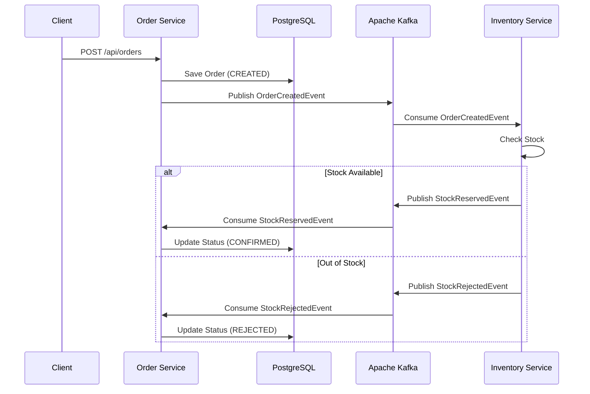

# 🏗️ Event-Driven E-Commerce Microservices Architecture


This repository serves as the umbrella project for a **production-ready, Event-Driven Microservices Architecture**. It demonstrates a **Choreography-based SAGA pattern** for distributed transactions, ensuring data consistency across multiple services without a centralized orchestrator.

## 🏛️ Architecture Overview

The system consists of two independent microservices communicating asynchronously via **Apache Kafka**:

1.  **Order Service (Port 8080)**: Manages customer orders. Initiates the SAGA by publishing `OrderCreated` events and listens for compensations.
2.  **Inventory Service (Port 8081)**: Manages product stock. Consumes `OrderCreated` events, reserves stock, and publishes `StockReserved` or `StockRejected` events.



## 📂 Repositories

This architecture is split into two main repositories (included here as Git Submodules):

*   [Order Service Repository](https://github.com/andres-figueroa-luna/order-service)
*   [Inventory Service Repository](https://github.com/andres-figueroa-luna/inventory-service)

## 🚀 How to Run the Entire Ecosystem

### Prerequisites
*   Docker & Docker Compose (Rancher Desktop or Docker Desktop).
*   Java 21 (Optional, for local development).

### 1. Clone the repositories
Clone this umbrella repository including its submodules:

```bash
git clone --recursive git@github.com:andres-figueroa-luna/event-driven-microservices-portfolio.git
```

### 2. Start the Infrastructure
From the root of this umbrella repository, run:

```bash
docker compose up --build
```

Docker Compose will orchestrate the entire system:
*   PostgreSQL Database (Port 5433)
*   Apache Kafka (Port 9092)
*   Order Service (Port 8080)
*   Inventory Service (Port 8081)

### 3. Test the API
Import the `bruno-collection` folder into [Bruno API Client](https://www.usebruno.com/) and execute the pre-configured requests to test the complete SAGA flow (Creation, Confirmation, Cancellation, and Compensation).

## ✨ Key Technical Features

*   **Choreography SAGA:** Distributed transaction management without a central orchestrator.
*   **Event-Driven Architecture:** Asynchronous communication using Spring Cloud Stream and Kafka.
*   **Resilience4j:** Circuit Breakers, Retries, and TimeLimiters for fault tolerance.
*   **Idempotency:** Database-level checks to prevent duplicate event processing.
*   **Dead Letter Queues (DLQ):** Kafka consumers route failed messages to DLQs to prevent blocking.
*   **API Documentation:** Fully documented endpoints with OpenAPI/Swagger.
*   **CI/CD:** Automated testing pipelines with GitHub Actions and Testcontainers.
*   **Production-Ready:** Containerized via Docker with multi-stage builds and health checks.

---
*Developed by Andrés Figueroa - Senior Java Developer*